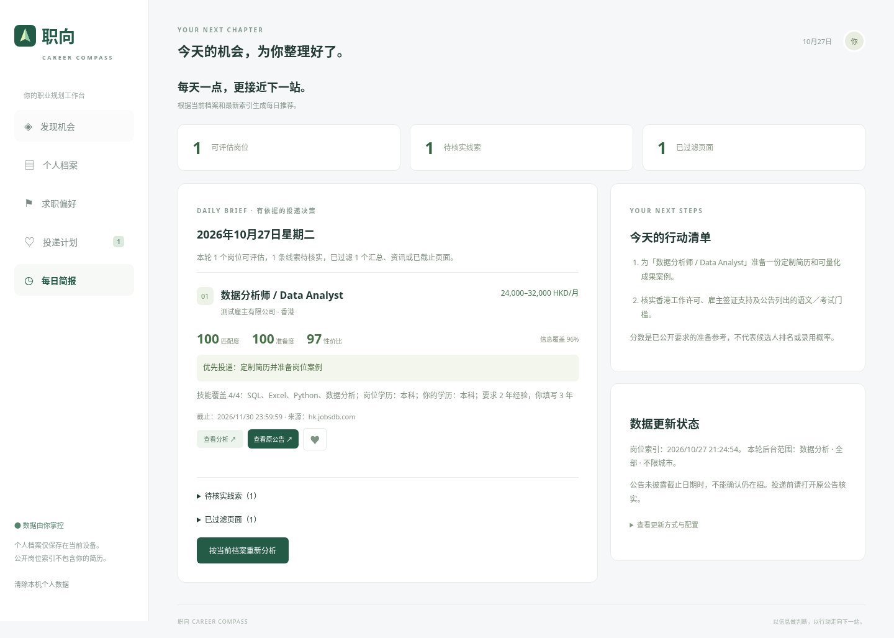

# 职向 · Career Compass

面向中国内地与香港的求职规划工作台：响应式网站 + 可安装 PWA。可运行的第一版使用可解释规则分析，不宣称掌握所有行业或预测录用率。原有 PDF 文件未改动，也不会被网站公开打包。

## 当前能力与边界

- 个人档案：学历、专业、毕业年份、技能、语言、工作／实习／项目经历、奖项、到岗时间、作品集与香港工作许可。年龄和性别为可选信息，不参与排序。
- 求职偏好：地区、城市、岗位、机构类型、月薪及币种、办公方式、用工类型、时间、专业与工作内容、排除关键词。
- 岗位页：内地／香港切换，央国企、外企、私企、公务员／公共机构、事业单位／高校、非营利组织等筛选，搜索、排序、来源与更新时间。
- 分析：0–100 匹配度、竞争准备度、投递性价比、信息覆盖度、缺失技能、门槛提示与行动建议。没有要求的数据不伪造分数，不把信息缺失当成满足。
- 收藏、投递状态、应用内每日简报、本机数据清除。
- 可选 Brave Search API 实时检索；可选 GitHub Actions 每日检索与应用内简报。**没有配置凭据时这些外部功能不运行。**
- 演示数据不会计入真实每日推荐。当前索引由每日任务更新，实际可评估数量取决于来源公开字段和访问规则。

默认使用共享公开岗位池，也支持部署按设备隔离的个人日报后端。尚无账号登录、跨设备同步、多实例数据库、原生 iOS/Android 包、后台 Web Push 或付费大模型对话。PWA 可安装到手机／电脑主屏幕，不能等同于 App Store 原生应用。工作时间和专业等偏好参与检索，但只有已披露的结构化条件才能可靠评分。

## 本地启动

Node.js >= 22。基础静态网站不需要第三方运行时；浏览器渲染与 UI 回归使用锁定版本的 Playwright，运行完整检查前请先 `npm ci`。

```sh
cd /workspace/resume
npm test
npm run build
npm run dev
```

默认监听 `127.0.0.1:3000`。局域网／容器使用 `HOST=0.0.0.0 npm start`。个人后端内置设备凭证、个人/全局持久额度和网络会话签发限制；公开部署使用 HTTPS 和持久磁盘，具体配置见个人日报部署指南。不要在客户端填写 API 密钥。

需要实时搜索时，从 `.env.example` 创建**未跟踪**的 `.env` 并在本机安全填值，再运行：

```sh
node --env-file=.env server.mjs
```

保存个人档案与偏好，并勾选允许发送检索关键词后点击“更新我的岗位日报”。`GET /api/status` 仅返回配置状态；个人接口需要设备凭证，跨域仅接受配置的 App origin 或同源 JSON 请求。服务器只转发白名单偏好、技能与专业字段，不发送姓名、性别、年龄、完整经历。

## 岗位检索、详情提取与质量分流

每日流程：用户目标关键词检索 → URL／标题过滤 → 公开职位页读取 → JobPosting 或明确文本字段提取 → 截止日期与证据检查 → 具体岗位／待核实线索／已过滤页面 → 浏览器按个人档案评分与日报。

- `src/sources.mjs`：仅允许内地与香港已支持的 HTTPS 招聘／政府来源，过滤平台首页、搜索汇总、招聘活动与 PDF 附件。
- `src/details.mjs`：优先解析 schema.org `JobPosting`，支持 `@graph`；含多个职位的页面不合并为一个。无结构化数据时，只有同时具备明确职位、具名雇主、职责和要求的页面才采用保守文本提取。
- 提取公司、城市、技能、学历、经验、明确月薪及币种、用工类型、发布日期、截止日期等，并为字段保留 `fieldEvidence`。不转换未经证实的年薪、税后薪资或汇率，不从平台域名猜企业性质。
- `src/pipeline.mjs`：全局最多 3 个并行读取，默认每次最多 36 次新详情读取（近期缓存不占读取次数），另有最多 6 个历史岗位复核；保留超限和失败原因。尊重 robots.txt，拒绝私网 DNS、未经允许的跳转、过大响应和非文本文件。不会绕过登录、验证码、付费或自动访问禁令；robots 获取异常也会列入待核实。
- `src/brief.mjs`：只把要求足够、方向对应且未明确截止的职位列入可评估区。待核实／方向待确认的线索单独收起，不凑固定 5 条推荐；生成技能准备、简历定制和资格核实任务。
- 在详情弹窗可展开字段证据。详情读取成功 **不等于** 人工核实或雇主确认在招；缺少截止日期的岗位须在申请前再次核实。

支持来源：内地智联、猎聘、前程无忧、国聘、国资委、人社部、国家公务员局及政府网站；香港 JobsDB、CTgoodjobs、劳工处、公务员事务局、招聘网站及 Indeed 香港。网站公开权限和字段并不一致，JavaScript 动态页、关闭公告、登录页或 robots 拒绝仍可能导致本轮 **0 个可评估岗位**。此时会展示具体原因，不会伪造分数。若需稳定覆盖这些来源，需要管理员取得其许可的数据接口或可公开获取的结构化招聘源；不要求普通用户配置爬虫。

搜索发现时间、详情读取时间、公告发布时间分别保存。后台检索偏好仅保存岗位／地区／城市／排除词，不发布个人简历。搜索 API 与详情来源不会收到彼此的凭据。

### 来源扩展、分页与额度

`sourceCatalog` 当前配置 41 个公开招聘入口，包括智联、猎聘、前程无忧、国聘、BOSS、JobsDB、CTgoodjobs、Indeed；牛客、实习僧、应届生求职网、GradConnection；腾讯、阿里、字节、华为、美团、百度、京东、网易、宝洁、联合利华、汇丰、渣打、安永、普华永道、德勤、港交所、港铁等企业招聘入口，以及公共部门来源。**这是公开来源注册表，不代表每站均有可用 API 或都能自动读到职位。** 不使用网站登录凭据、不绕过反爬或验证码。

各岗位方向分别构造中英关键词，按地区查询。每个查询混合平台／公共部门、校招、企业官网渠道，轮换企业来源；金融和快消方向优先选择相应行业企业入口。公开招聘入口页会额外尝试发现最多 8 个已允许来源的具体职位链接（每轮最多检查 4 个入口），入口本身不会计为具体岗位。

分页使用 Brave `offset`，仅在服务声明还有结果（或完整页未明确结束）时请求下一页。重复页和无后续结果会停止。默认每个查询最多 2 页；先覆盖不同方向首屏，再分配后续页，避免某个方向耗尽预算。默认将检索范围扩大到近一年收录，再由原公告截止日期／职位状态筛除失效岗位，避免漏掉持续开放的校招。

每天北京时间重置 24 次请求预算（31 天约 744 次），当天已用量随公开索引保存，因此正常手动重跑共享额度。搜索账户自身的额度／收费以 Brave 后台为准；其他项目使用、未保存的全失败运行或外部请求不在本索引计数之内。该公共预算计数由 GitHub 公开索引持久保存。新个人后端另用私有数据卷记录个人与全局额度，和公共任务分开计数，不能把两者当作同一个账户账单。每轮有搜索耗时上限；达到预算或时限时披露未完成覆盖，保留已有数据，不静默增加付费请求。网页“加载最新日报”不调用搜索 API。

可选 GitHub Actions Variables（不设置即使用默认值，无需新增密钥）：

| Name                | 默认 | 范围与用途                                                     |
| ------------------- | ---- | -------------------------------------------------------------- |
| `JOB_SEARCH_BUDGET` | `24` | 每日搜索请求预算，1–100；提高前先核对服务额度与费用            |
| `JOB_SEARCH_PAGES`  | `2`  | 每个查询最多页数，1–3；受总预算限制                            |
| `JOB_DETAIL_LIMIT`  | `36` | 每轮新详情读取限额，1–100；不增加 Brave 请求但增加来源读取时间 |

### 历史池与去重

新检索没有命中旧岗位时，不直接删除：近期仍可参考的详情标注“历史保留”，保留原读取时间并提示投递前核实。每次最多复核 6 个超过 24 小时未读取的历史岗位；近期详情缓存可复用，避免重复读取。超过 7 天未成功复核的详情转入待核实；最后有效活动超过 30 天、明确截止、页面关闭、404／410 或不符合当前城市／应届／用工／排除词条件的退出有效池。普通未核实线索最多保留 14 天。未披露截止日不等于已确认仍在招。

`src/history.mjs` 先按规范 URL 去重，再对具名雇主、职位、地点、完整职责、薪资和截止日期均一致的详细岗位去重；相同内容优先保留企业官网链接，并保存其他来源。不会仅因同公司同标题就把不同团队职责合并。原始发现时间、最近被检索到时间、最近详情读取时间分别记录。

### 自动升级现有索引

`.github/workflows/enrich.yml`（**Upgrade existing job details**）在详情解析相关代码更新时自动运行，也可手动触发。它无需新增 API 密钥，会重新处理仓库中已有的公开链接、写入处理统计和失败原因、保存索引并部署。不会把本机浏览器档案上传。此任务不执行新关键词搜索。

正常每日流程继续由 **Daily job discovery** 负责，已自动包含详情处理。检索策略或每日工作流更新推送后也会自动触发一次完整检索，复用已有密钥，无需用户手动重跑。数据写入保留远端并发修改，避免 force push；所有 Pages 部署共用串行部署组。

## 评分口径

`src/match.mjs`：技能 35、学历 15、经验 20、城市 10、同币种薪资 15、办公方式 5。填写目标岗位时增加岗位方向 15 权重，使用透明关键词／常见中英名称对应，无法对应的放入方向待确认区。只对有资料的维度归一化，覆盖度单独展示（填写方向时总权重 115，否则 100）。只有搜索摘要、没有个人背景，或核心任职条件权重不足 35／全部已知权重不足 50 时不生成数字分数。薪资以月薪为标准，不做未经证实的汇率或年薪转换。

竞争准备度 = 匹配度 × 0.85 + 有填写成果 10 分 + 有填写经历 5 分。填写本身不等于核实成果质量，因此只作为准备提醒。性价比 = 匹配度 × 0.65 + 准备度 × 0.25 + 时间便利度 × 0.10，硬性门槛不满足扣 15 分；申请时间默认 30 分钟，是可调整的规划假设。75 分及以上优先，50–74 选择性投入，低于 50 建议先补齐差距；门槛和截止日期提示优先于总分。

**不是候选人排名、录用概率或薪酬承诺。** 缺少申请人数、候选人分布等数据时不能计算真实竞争强度。专业、语言、签证、公共部门资格及专业考试要求须核验原公告；年龄、性别不用于评分。未披露条件不代表没有限制。

## GitHub 网站部署

1. 推送到 `main`。仓库 Settings → Pages → Build and deployment 选择 **GitHub Actions**。
2. `.github/workflows/pages.yml` 执行测试、构建并发布 `dist/`。
3. 项目 Pages 通常为 `https://winne-wang0505.github.io/resume/`；以 Actions 成功部署后的实际地址为准。代码推送成功不能代表网页已经发布。
4. 网站所有资源使用相对路径，可部署到仓库子路径。`dist/` 不包含 PDF、测试、环境文件或服务端密钥。
5. iOS Safari：分享 → 添加到主屏幕；Android Chrome：安装应用／添加到主屏幕。桌面 Chrome/Edge 可从地址栏安装。需要 HTTPS。浏览器安装兼容性应在目标设备验证。

GitHub Pages 只有静态文件，没有 Node API。在线网站的“实时检索”需要把整个应用部署到可运行 Node 的服务器，或通过每日任务更新静态索引。不要把密钥写入 Pages、仓库变量中的公开配置或浏览器。

## 每日自动推荐（仅应用内）

`.github/workflows/daily.yml` 每天北京时间 08:00 调度（GitHub 可能延迟，低活跃公开仓库也可能停用定时任务）；支持手动触发。运行 `npm run jobs:refresh` 更新公开索引并重新部署 Pages。没有搜索密钥会明确失败，保留现有索引；全部查询失败时保留旧索引并报错；部分查询失败时保留已取得结果和可参考的历史岗位，并在统计中披露未完成覆盖。

在仓库 Settings → Secrets and variables → Actions 配置：

| 类型     | 名称                       | 用途                                |
| -------- | -------------------------- | ----------------------------------- |
| Secret   | `BRAVE_SEARCH_API_KEY`     | Brave Search API 密钥，必需用于检索 |
| Variable | `JOB_ROLE`                 | 目标岗位，默认“数据分析”            |
| Variable | `JOB_REGION`               | `全部`、`内地`、`香港`              |
| Variable | `JOB_CITY` / `JOB_EXCLUDE` | 城市／逗号分隔排除词                |

支持岗位和城市用 `/`、`、` 或逗号分隔。每个岗位方向独立检索（最多 9 个方向，内地／香港最多 18 个首屏查询），默认每个查询最多 2 页，共享每天 24 次搜索请求预算；首次查询覆盖后才继续翻页，并公平分配地区、方向与来源渠道的详情额度。`JOB_EXCLUDE` 用相同分隔符填写；在详情阶段再次检查排除词。可额外设置 `JOB_EMPLOYMENT`（如全职、实习或不限）和 `JOB_EXPERIENCE`（如应届、不限）；应届配置不会将明确要求工作年限的岗位列为可投递机会。

推荐分开保存变量，例如：

| Name             | Value                                              |
| ---------------- | -------------------------------------------------- |
| `JOB_ROLE`       | `数据分析/大模型/AI/产品/算法/开发/运营/金融/快消` |
| `JOB_REGION`     | `全部`                                             |
| `JOB_CITY`       | `上海/杭州/深圳/香港`                              |
| `JOB_EXCLUDE`    | `夜班/销售`                                        |
| `JOB_EMPLOYMENT` | `不限`                                             |
| `JOB_EXPERIENCE` | `应届`                                             |

若早期误将 `JOB_TYPE：… JOB_REGION：… JOB_EXCLUDE：… JOB NATURE… JOB EXPERIENCE：…` 整段填入 JOB_ROLE，程序会兼容拆分并在数据状态标注，但分开配置更清楚。多用工类型在检索时不设单一类型限制；实际岗位用工类型仍需按详情核实。

按照用户选择，仅在应用内展示推荐，不实现邮件发送。浏览器“导出偏好”只导出偏好，不包含经历，也不会自动同步到 Actions。定时公共索引按 JOB_* 检索，打开应用时再按当前设备个人档案生成个性化评分与简报；静态站点不能在关闭时持续执行个性化后台任务。每日任务不执行自动投递。

## 隐私与生产化建议

完整个人档案存于浏览器 localStorage；个人后端只存经同意的检索关键词、个人岗位池及设备会话哈希，尚无跨设备同步。同一域名下脚本可以读取，勿在共享设备长期保存敏感数据。检索服务只收到偏好、技能和专业白名单关键词；来源链接会在新窗口打开。网页不加载第三方字体或分析脚本。可在侧栏或个人档案页清除本机数据；清除操作不能删除已导出的文件。

当前个人后端面向小规模单实例试用，已提供设备鉴权、定时开关、删除和持久额度。扩展为正式账号与多实例系统仍需共享数据库、账号登录、可靠队列和相应隐私管理。评分是透明的规则版，需要行业数据与用户反馈后再校准。

## 验证

`npm test` 覆盖高匹配、缺失信息、年龄性别不参与、不同币种、资格门槛、截止日期、URL 安全、关键词最小化、来源过滤、重复去除、搜索失败及部分失败。`npm run build` 输出静态网站。真实搜索、来源访问结果、GitHub Pages 与手机安装须分别验收。升级新增详情证据、月薪单位、页面分类、robots、重定向、私网防护、低信息不评分、日报分流等测试。

## 界面预览

桌面与手机尺寸截图来自本地浏览器验证，不代表线上已发布。


[手机界面截图](docs/screenshots/mobile.png)

### 升级后的日报布局

以下截图使用合成测试岗位，仅展示信息布局、证据入口与分流，不代表真实推荐或招聘结果。



[升级版日报手机界面](docs/screenshots/daily-mobile.png)

### 数据源与正文导入迭代

当前优先企业官网和校招，支持 41 个公开来源入口（入口不代表授权 API 或稳定可读）。腾讯/字节的部分公开内嵌岗位 JSON 增加按职位 ID 的专用适配；原有结构化和正文解析继续使用。GitHub 定时任务增加最多 4 次受控浏览器渲染，实际受限页面仍如实标记待核实。

每日简报可查看“来源读取健康状态”：连续访问限制会暂缓读取并在之后复查。也可展开“粘贴岗位正文进行分析”，将无法自动读取的单个岗位保存到本机，并沿用现有评分、收藏与投递计划。手动正文不会上传到 GitHub，也不会被标为自动核验。

[功能基线与回归验收](docs/FEATURE_BASELINE.md)记录必须保留的功能、测试和当前 MVP 边界，后续迭代以此检查，避免功能漂移。

### 用户自主搜索与个人日报

“求职偏好”现在提供个人服务连接、日报需求保存和每日检索开关。常驻个人后台提供设备会话隔离、独立岗位池、定时更新、持久化额度和数据删除。App 的个人需求会驱动真实搜索，不修改 GitHub 公共任务变量。原共享日报仍可继续使用。

**GitHub Pages 本身不能运行后台。个人后端尚需管理员部署后才能在公网启用。** 已提供 Docker 和 Render Blueprint；具体步骤、费用确认和默认额度见 [个人日报部署指南](docs/PERSONAL_SERVICE.md)。可直接使用部署后的完整 App，也可让原 Pages/PWA 连接该服务。
